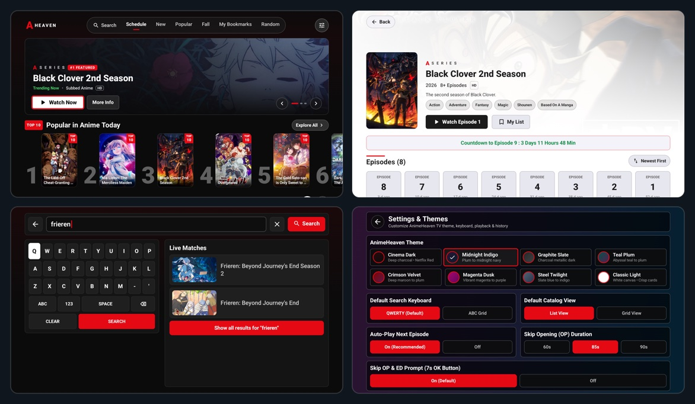

# AnimeHeaven TV (`me.animeheaven.tv`)

Native Jetpack Compose + Media3 Android TV application for browsing and streaming anime from `animeheaven.me`, engineered for low-RAM TV sticks (1080p/4K), D-pad navigation, fast cold start, and stall-free playback.

> **Companion Repository**: For the phone and tablet touch edition (`me.animeheaven.android`), see the sibling repository `animeheaven-android`. Both repositories share the core data, Room persistence, HTML parsing, predictive preloading, and multi-mirror Media3 video caching engine while tailoring their manifests, UI chrome, navigation, search input, and player interactions to their respective form factors.

## Screenshots

<p align="center">
  
</p>
<p align="center"><sub>Home (Cinema Dark) · Anime Detail (Classic Light) · D-Pad Search Keyboard · Settings &amp; 8 Themes (Midnight Indigo)</sub></p>

---

## Key Capabilities

- **Android TV Native UX**: Leanback launcher integration (`LEANBACK_LAUNCHER`), 36dp horizontal / 18dp vertical overscan-safe framing, custom `Modifier.Node` D-pad focus highlights, and a D-pad custom keyboard (`QWERTY`, `ABC`, `Symbols`).
- **Instant Cold Start**: Off-main-thread lazy subsystem initialization (`AppContainer`) with fast `home_snapshot.v1.json` hydration before Room or network requests finish.
- **Multi-Mirror Parallel Streaming & Caching**: Shared byte-length episode cache keys (`ep:<episodeKey>:<contentLength>`), throughput-ranked mirror failover (`MirrorHealthTracker`), 512 KB parallel HTTP range boosting (`StreamingChunkBooster`), and non-faststart MP4 `moov` tail warming.
- **AniSkip & AniList Integration**: Coalesced AniList `idMal` resolution + AniSkip OP/ED timestamp overlays with configurable fallback manual skip (`default 85s`) and Up Next auto-play countdown.
- **8 Built-In Themes**: Pure OLED Dark (`dark`), 6 dark gradient palettes (`dark2`–`dark7`), and Classic Light (`light`), cached statically to prevent runtime color allocations.
- **Small Binary Footprint**: R8 full mode, `material-icons-core` + custom extracted vectors in [`AhIcons.kt`](app/src/main/java/me/animeheaven/tv/ui/components/AhIcons.kt), English-only resource packaging, and a targeted Baseline Profile.

---

## Tech Stack

| Layer | Technology / Library | Version |
| :--- | :--- | :--- |
| Language / Build | Kotlin, AGP, KSP | `2.0.21` / `8.7.3` / `2.0.21-1.0.28` |
| Android SDK | `minSdk 24`, `targetSdk 35`, `compileSdk 35`, Java 17 | — |
| UI | Jetpack Compose (`composeBom`), Material 3, Navigation Compose | `2025.02.00` / `2.8.6` |
| Media Playback | Media3 (`exoplayer`, `ui`, `datasource-okhttp`) | `1.5.1` |
| Networking & Parsing | OkHttp, Jsoup | `4.12.0` / `1.18.3` |
| Images | Coil 3 (`coil-compose`, `coil-network-okhttp`) | `3.0.4` |
| Persistence | Room (`room-runtime`, `room-ktx`, `room-compiler`) + `SharedPreferences` | `2.6.1` |
| Concurrency & Startup | Kotlinx Coroutines, ProfileInstaller | `1.9.0` / `1.4.1` |
| Testing | JUnit 4, `kotlinx-coroutines-test` | `4.13.2` / `1.9.0` |

Dependency versions are centralized in [`gradle/libs.versions.toml`](gradle/libs.versions.toml).

---

## Quick Start

### Prerequisites
- JDK 17
- Android SDK Platform 35 + Build Tools (configured via `local.properties` or `ANDROID_HOME`)

### Common Commands

```bash
# Run all JVM unit tests
./gradlew testDebugUnitTest

# Build debug APK
./gradlew assembleDebug

# Build R8-minified release APK + run lintVitalRelease
./gradlew assembleRelease

# Build release APK with Compose compiler stability & skippability reports
./gradlew testDebugUnitTest lintDebug compileDebugAndroidTestKotlin assembleRelease -PcomposeCompilerReports=true

# Install an R8-optimized, debug-signed build with a separate application ID
./gradlew installSideload
```

Release APKs are unsigned unless all of `KEYSTORE_FILE`, `KEYSTORE_PASSWORD`, `KEY_ALIAS`, and `KEY_PASSWORD` are set as environment variables or Gradle properties. Use `-PversionCode=… -PversionName=…` to set release versions. Auto Backup is disabled; local settings and watch history are not restored after reinstall.

Compose compiler reports are generated under `app/build/compose_compiler/` when `-PcomposeCompilerReports=true` is passed.

---

## Repository Structure

```text
app/
├── compose_stability.conf                  # Explicit stability contracts for library references
├── proguard-rules.pro                      # R8 full-mode optimization & selective keep rules
└── src/
    ├── main/
    │   ├── AndroidManifest.xml             # Leanback + landscape activity declaration
    │   ├── baseline-prof.txt               # Targeted AOT Baseline Profile rules
    │   └── java/me/animeheaven/tv/
    │       ├── AnimeHeavenApplication.kt   # Application startup, Coil singleton, trimMemory hook
    │       ├── AppContainer.kt             # Lazy DI container & async warm-up coordinator
    │       ├── MainActivity.kt             # Theme-scoped Compose root & overdraw removal
    │       ├── data/
    │       │   ├── cache/                  # VideoCacheManager, StreamingChunkBooster, AnimePreloader, Codecs, LRU
    │       │   ├── local/                  # Room database (v3) & SharedPreferences settings store
    │       │   ├── model/                  # @Immutable UI/domain models & theme/preload enums
    │       │   ├── network/                # OkHttp client, DNS cache, NetworkPolicy, AniSkip/AniList
    │       │   ├── parser/                 # Pre-compiled Jsoup HTML selectors & parsers
    │       │   └── repository/             # Offline-first SWR repository & RequestCoalescer
    │       └── ui/
    │           ├── components/             # TvFocusModifiers, TvCustomKeyboard, AnimeHeavenHeader, Cards, AhIcons
    │           ├── navigation/             # NavHost routes & ViewModel factories
    │           ├── screens/                # Home, Catalog, Bookmarks, Detail, Search, Player, Settings
    │           └── theme/                  # Static cached palettes & Typography
    └── test/java/me/animeheaven/tv/        # 8 JVM unit test suites (no device required)
```

---

## Documentation Index

- **[Architecture & TV UI Guide](docs/ARCHITECTURE.md)** — Startup wiring, data flow, navigation routes, ViewModels, `Modifier.Node` focus engine, custom keyboard, and remote key bindings.
- **[Video Playback, Caching & Preloading](docs/VIDEO_AND_CACHING.md)** — 3-tier caching, Room schema, streaming JSON snapshot codec, `VideoCacheManager`, `StreamingChunkBooster`, `MirrorHealthTracker`, and 3-band `AnimePreloader`.
- **[Performance, Build & Contributor Guide](docs/PERFORMANCE_AND_BUILD.md)** — Compose skippability rules, R8 full-mode configuration, unit tests, and invariants to preserve when making changes.
